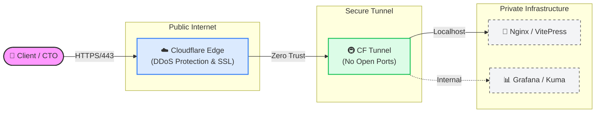

> **Problem:** AWS IAM accounts quietly accumulate over-privileged access, and the principle of least privilege has no routine check.
>
> **What this is:** an AWS IAM least-privilege auditor: it reviews IAM configurations, identifies over-privileged accounts and helps enforce least privilege. **AWS only — GCP is not implemented** (running with `--provider gcp` exits with an error saying so).
>
> **Who it is for:** AWS account owners and auditors reviewing their own accounts.
>
> **Quickstart:**
>
> ```bash
> git clone https://github.com/ranas-mukminov/Cloud-IAM-Optimizer.git
> cd Cloud-IAM-Optimizer
> pip install -r requirements.txt
> python3 -m unittest discover -s tests -v
> ```
>
> **Sample result (verified with requirements installed, mocked boto3, no cloud access):** `Ran 17 tests, OK`.
>
[](https://github.com/ranas-mukminov/Cloud-IAM-Optimizer/actions)

---
# Cloud-IAM-Optimizer


**AWS IAM Least Privilege Auditor**

Cloud-IAM-Optimizer is a tool designed to audit AWS Identity and Access Management (IAM) configurations. It helps you identify over-privileged accounts and enforce the principle of least privilege. GCP support is planned but not implemented yet: running with `--provider gcp` currently exits with an error stating only `--provider aws` is supported.

**Commercial Brand:** [run-as-daemon.dev](https://run-as-daemon.dev)

## Architecture




## Features

- **AWS Support:** Audit AWS IAM policies. GCP is not implemented yet (see above).
- **Least Privilege Analysis:** Identify unused permissions and risky configurations.
- **Flexible Output:** Generate reports in JSON or human-readable text formats.
- **CLI Interface:** Easy-to-use command-line interface for integration into CI/CD pipelines.

## Quick Start

### ⚡ 5-Second Audit (MVP)

Run this to find security holes in 5 seconds (requires configured AWS credentials):

```bash
python audit.py
```

### Full CLI Tool


1.  **Clone the repository:**
    ```bash
    git clone https://github.com/ranas-mukminov/Cloud-IAM-Optimizer.git
    cd Cloud-IAM-Optimizer
    ```

2.  **Install dependencies:**
    ```bash
    pip install -r requirements.txt
    ```

3.  **Run an audit:**
    ```bash
    python src/main.py audit --provider aws --output text
    ```

## Usage

```bash
Usage: main.py audit [OPTIONS]

  Run an IAM audit for the specified provider.

Options:
  --provider [aws|gcp]  Cloud provider to audit.  [required]
  --output [json|text]  Output format.
  --help                Show this message and exit.
```

## Tests

Unit tests use a mocked boto3 IAM client, so no cloud credentials are needed:

```bash
pip install -r requirements.txt
python -m unittest discover -s tests -v
```

Test run verified in this update (mocked boto3, no cloud access): 17 tests, OK.

## Commercial Support

We offer professional support and auditing services for your cloud infrastructure.

- **Infrastructure Audit:** Comprehensive security and performance analysis.
- **Monitoring & Backup:** Implementation of robust monitoring and backup solutions.
- **DevOps/SRE Support:** Ongoing support for your development and operations teams.

For commercial inquiries and support, please visit: **[run-as-daemon.dev](https://run-as-daemon.dev)**

> [!NOTE]
> For Russian Federation compliance inquiries, please visit our local mirror: [run-as-daemon.ru](https://run-as-daemon.ru)

## Privacy & Compliance

This tool is designed to be run within your own infrastructure. It does not send any data to external servers.

- **Data Collection:** The tool processes IAM data locally to generate reports.
- **Logs:** No sensitive data is logged by default. Ensure you configure your environment to handle logs securely.
- **Compliance:** Users are responsible for ensuring compliance with local regulations (e.g., 152-FZ in Russia) when using this tool in production.

## License

This project is licensed under the MIT License - see the [LICENSE](LICENSE) file for details.

---
Copyright (c) 2025 Ranas Mukminov | [run-as-daemon.dev](https://run-as-daemon.dev)
